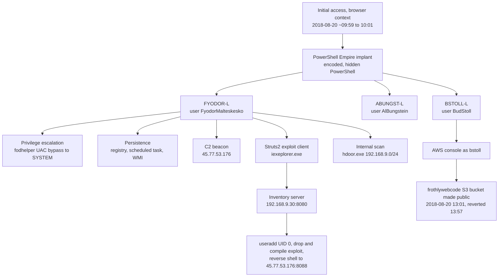

# Intrusion overview

How the three investigations fit into one operation against Frothly on 2018-08-20. Endpoint
evidence is Sysmon, cloud evidence is AWS CloudTrail.

- Investigation 1 covers the cloud side (`bstoll`, IAM, the public S3 bucket).
- Investigation 2 covers the endpoint side on FYODOR-L (implant, Struts2, C2, scanning).
- Investigation 3 correlates the implant across BSTOLL-L, ABUNGST-L, and FYODOR-L and ties
  the endpoint and cloud sides through the `bstoll` / BudStoll identity.
