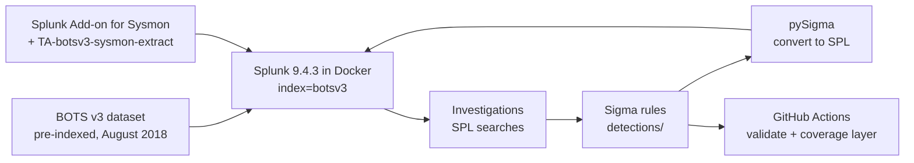

# Lab architecture

The lab is a single Splunk instance in Docker, loaded with the pre-indexed BOTS v3 dataset. There is no live victim network. All telemetry comes from the dataset.

## Components

| Component | Detail |
|---|---|
| Host | MacBook Pro, Apple Silicon (arm64) |
| SIEM | `splunk/splunk:9.4.3`, amd64 image under emulation, see `docker-compose.yml` |
| Data | BOTS v3, 1,944,092 events across 107 sourcetypes, index `botsv3` |
| Cloud telemetry | AWS CloudTrail (JSON, automatic field extraction) |
| Endpoint telemetry | Sysmon, searched as `sourcetype=XmlWinEventLog` |
| Field extraction | `splunk/TA-botsv3-sysmon-extract` (this repo) |
| Rule tooling | pySigma with the Splunk backend, `tools/validate_rules.py` |

Setup steps are in [splunk-setup.md](splunk-setup.md).

## Why a dataset and not a live lab

A Windows Active Directory lab does not run natively on Apple Silicon, and a cloud-hosted one was out of scope for this version. BOTS v3 gives real multi-source telemetry of a full intrusion, which is enough to practise investigation and to validate rules against known attacker activity. The cost is that the rules are only tested against this one dataset. See the limitations in the main README.
